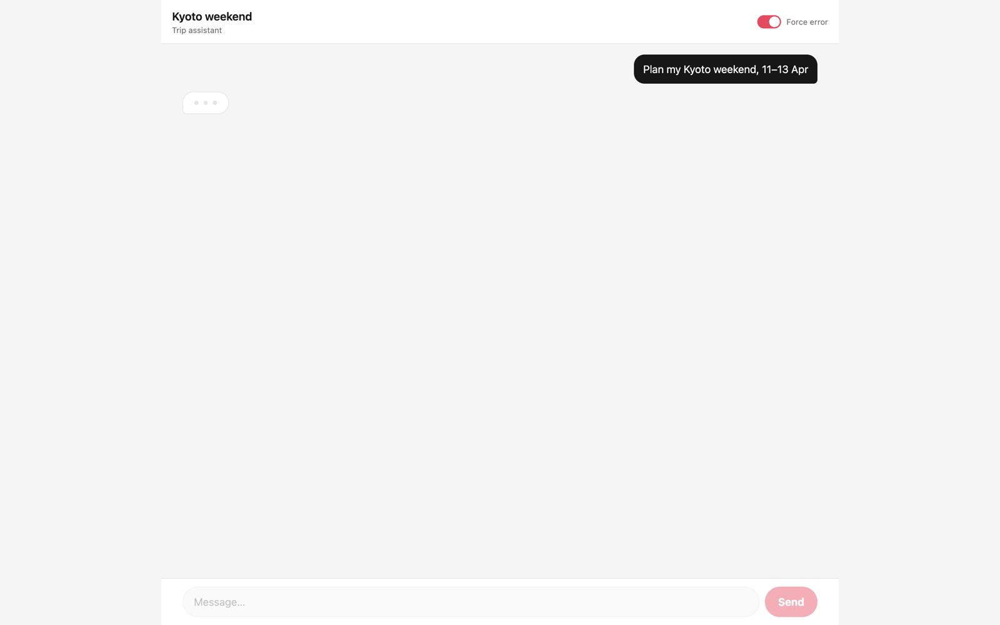
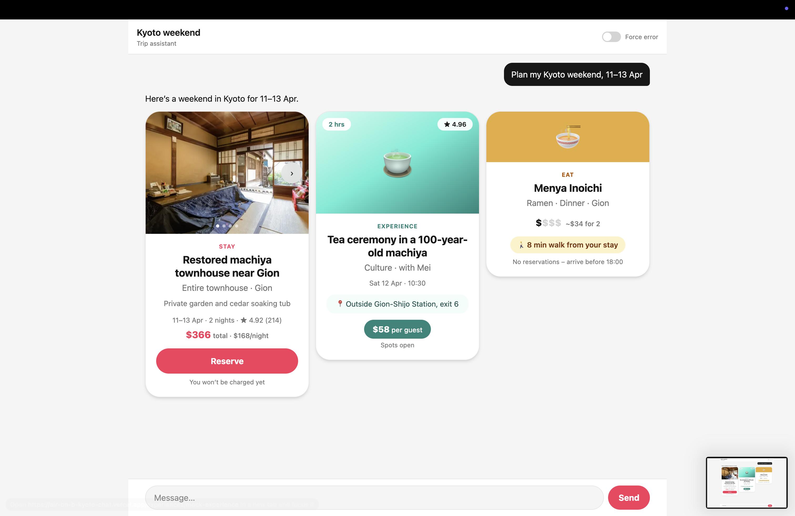
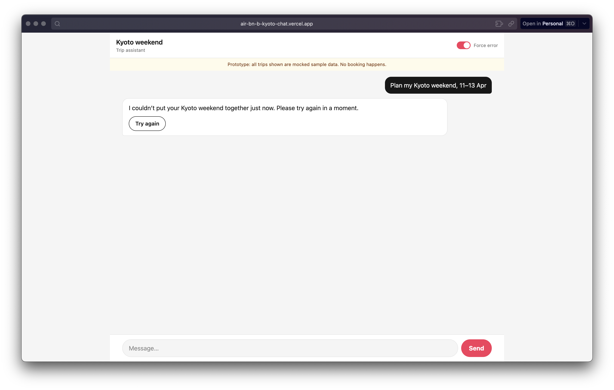
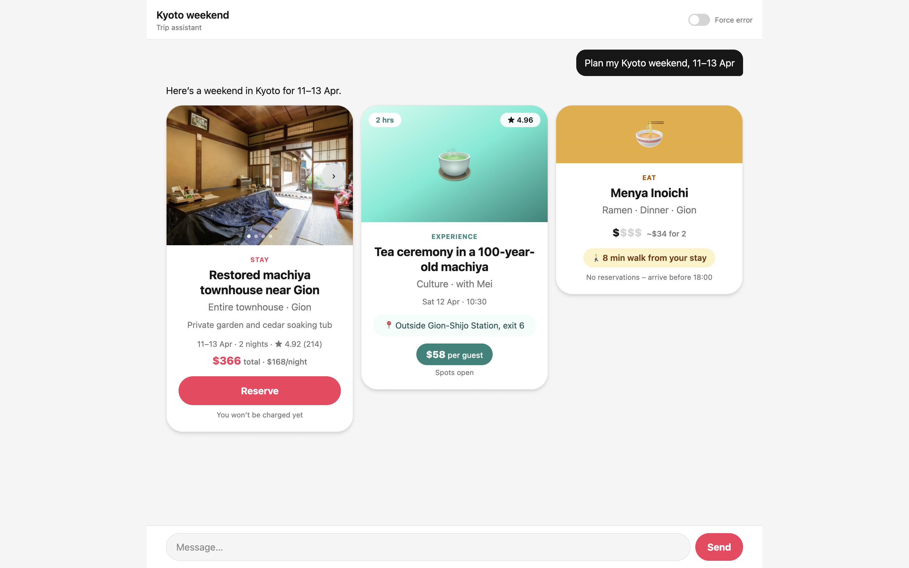
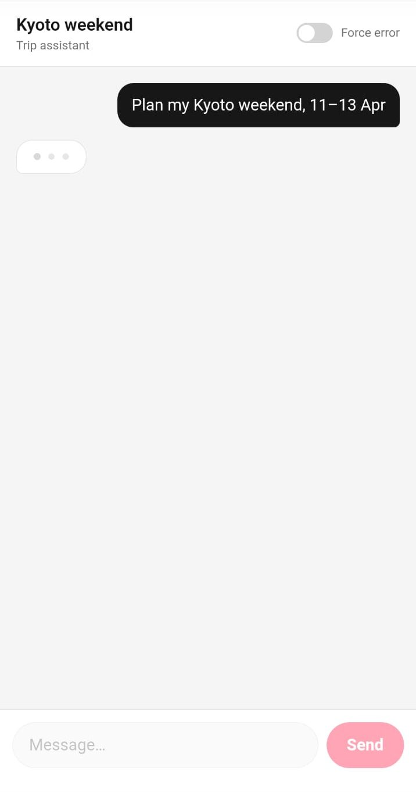
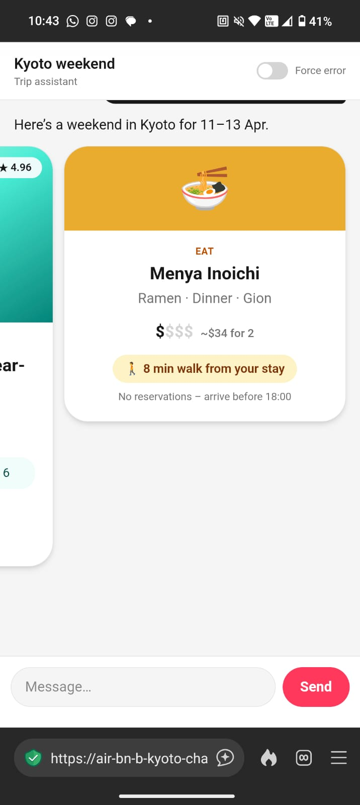
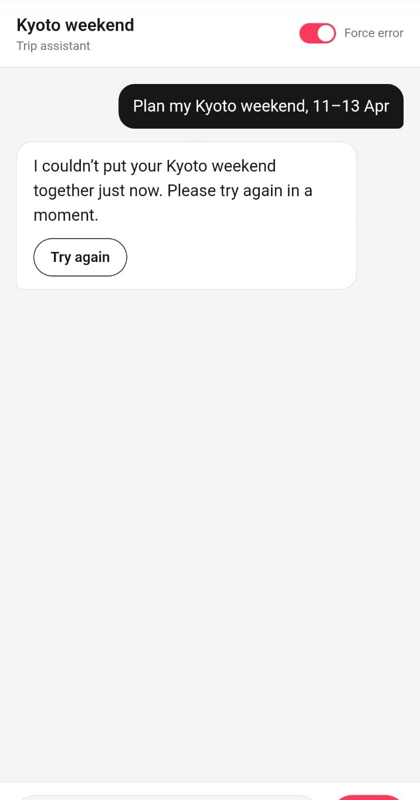
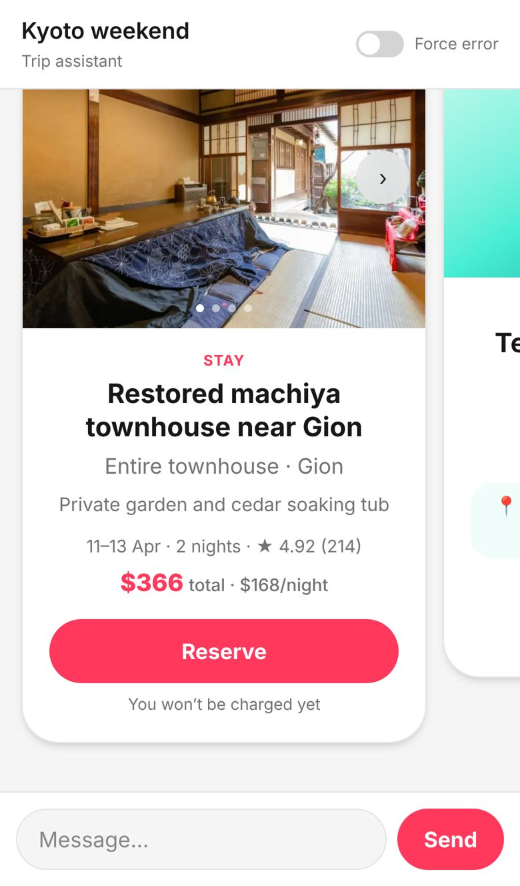

# Kyoto weekend chat

**Researchers: try the live prototype at https://air-bn-b-kyoto-chat.vercel.app/ (no login, sample data only).**

A one-page chat prototype that plans a Kyoto weekend (11–13 Apr). It shows a thinking bubble, then three cards: a stay, an experience and a place to eat. If it can't build all three, it shows a calm error bubble with a Try again button.

## Screenshots (desktop)

Screenshots from the [live site](https://air-bn-b-kyoto-chat.vercel.app/).

**1. Thinking.** Sending locks the input and shows pulsing dots in the reply bubble.



**2. Cards.** Stay, experience and eat appear one after another, side by side.



**3. Error.** With Force error on, the reply is a calm message with Try again inside it.



**4. Try again clicked.** It turns Force error off, thinks, and brings the three cards back.



## Screenshots (mobile)

Screenshots from the [live site](https://air-bn-b-kyoto-chat.vercel.app/).

On a phone the cards become a swipeable carousel that snaps card to card.

| 1. Thinking | 2. Cards | 3. Swiped to eat | 4. Error | 5. Try again clicked |
|---|---|---|---|---|
|  |  |  |  |  |

## Run it

```bash
npm install
npm run dev
```

Open http://localhost:3000. Other scripts: `npm run build`, `npm run typecheck`.

## Pass checklist

Two setups. **Phone:** iPhone 14, Safari, about 390 px, private window. **Laptop:** 13-inch MacBook Air, Chrome, about 1440 px, incognito window. Nothing is logged in on either (no Airbnb, no Vercel).

Marks: ✅ checked in a browser at that width on a local build (Chromium, not the real device) · ❌ fails today · ☐ not checked yet · n/a does not apply.

### What a prototype must do before it goes in front of a guest

| # | Rule | Phone | Laptop |
|---|---|---|---|
| 1 | One typed trip request shows a thinking state first. | ✅ | ✅ |
| 2 | Then it shows 3 of 3 cards: a stay card, an Experience card and a food card. | ✅ | ✅ |
| 3 | The three cards look clearly different, not one layout with the text swapped. | ✅ | ✅ |
| 4 | At phone width nothing is cut off and nothing needs sideways scrolling. | ✅ the three cards are stacked one below the other | n/a |
| 5 | The forced failure shows a friendly message and a Try again button inside the assistant bubble. | ✅ | ✅ |
| 6 | 0 blank-chat moments, including when the failure shows, when Try again is pressed, and after it. | ✅ | ✅ |
| 7 | Pressing Try again brings the 3 cards back. | ✅ | ✅ |
| 8 | The link opens with no setup, no sign-up and no login (no install, no configuration). | ✅ | ✅ |
| 9 | A visible note on the page says the data is mocked and no booking happens. | ✅ | ✅ |

Notes:
- Rule 4: on a phone the cards are stacked and you scroll the chat up and down to see all three. The only sideways movement left is the optional photo swipe inside the stay card (arrows also work); the cards themselves never need it.
- Rule 6 was measured at both widths. The one blank moment found is a short gap at first load (about 50 ms), before the thinking bubble appears. None showed during failure, Try again or after.
- Rule 9: the page now shows "Prototype: all trips shown are mocked sample data. No booking happens." under the header, in every state. The live site shows it after the next push to `main` finishes deploying.
- Rule 8 needs the live link opened in a private window on each setup.

### Vercel links (from Kevin Marsh, Web Platform)

| # | Rule | Phone | Laptop |
|---|---|---|---|
| 10 | Share only the project's production `*.vercel.app` domain, the one listed under Domains in the Vercel dashboard. Never share a preview link (the long URL with a hash and a team or user name), because it asks for a Vercel login. | ✅ | ✅ |
| 11 | Before sharing, open the production link in a private window and confirm it loads without a login. | ✅ | ✅|
| 12 | Wait until the newest deployment shows as finished in the Deployments tab before testing (every push to `main` redeploys production), so you don't test the old version. | ✅ | ✅ |

## What it does

- Sending a message locks the input and shows pulsing dots in the reply bubble before any cards appear.
- The three cards fade in one after another. On desktop they sit side by side; on mobile they're a swipeable carousel.
- The stay card has a photo carousel and a Reserve button. The experience card shows its price as a pill and its meeting point in a row. The eat card shows a `$` scale and a walk-time chip.
- The **Force error** switch in the header makes the next reply fail so you can see the error bubble. **Try again** turns the switch off, thinks, and brings the three cards back.
- Light mode only.

## Stack

Next.js (app router), React 19, TypeScript (strict), Tailwind CSS v4.

## Layout

- `app/`: page, layout, Tailwind theme and animations
- `components/Chat.tsx`: thread, thinking, error and retry logic
- `components/cards/`: `StayCard`, `ExperienceCard`, `EatCard`, plus the shared `CardFrame`
- `lib/mock.ts`: sample reply built from one row per sheet of the Kyoto Weekend Prototype Content Pack (empty fields show "TBC")
- `types/chat.ts`: message and card types
- `public/`: stay photos
