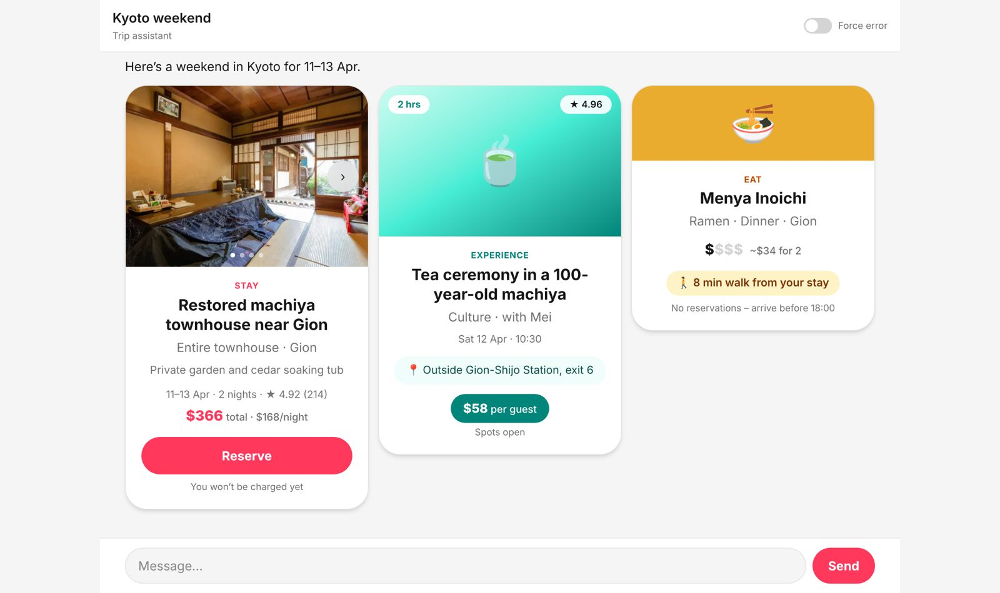

# Kyoto weekend chat

A one-page chat prototype that plans a Kyoto weekend (11–13 Apr). It shows a thinking bubble, then three cards: a stay, an experience and a place to eat. If it can't build all three, it shows a calm error bubble with a Try again button.



## Run it

```bash
npm install
npm run dev
```

Open http://localhost:3000. Other scripts: `npm run build`, `npm run typecheck`.

## What it does

- Sending a message locks the input and shows pulsing dots in the reply bubble before any cards appear.
- The three cards fade in one after another. On desktop they sit side by side; on mobile they're a swipeable carousel.
- The stay card has a photo carousel and a Reserve button. The experience card shows its price as a pill and its meeting point in a row. The eat card shows a `$` scale and a walk-time chip.
- The **Force error** switch in the header makes the next reply fail so you can see the error bubble. **Try again** turns the switch off, thinks, and brings the three cards back.
- Light mode only.

## Stack

Next.js (app router), React 19, TypeScript (strict), Tailwind CSS v4.

## Layout

- `app/`: page, layout, Tailwind theme and animations
- `components/Chat.tsx`: thread, thinking, error and retry logic
- `components/cards/`: `StayCard`, `ExperienceCard`, `EatCard`, plus the shared `CardFrame`
- `lib/mock.ts`: sample reply built from one row per sheet of the Kyoto Weekend Prototype Content Pack (empty fields show "TBC")
- `types/chat.ts`: message and card types
- `public/`: stay photos
